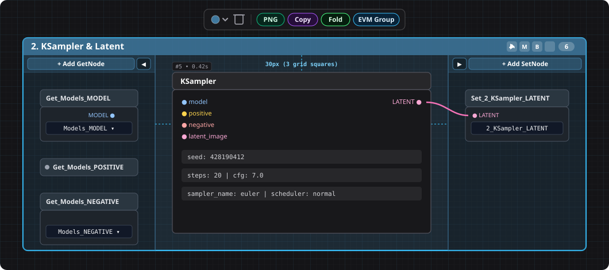

# ⚡ ComfyUI-EVM-Advanced-Group

**EVM Advanced Group** é um sistema de containers de grupo inteligentes para o **ComfyUI**, projetado para manter workflows complexos limpos, modulares, sem fios cruzando o canvas ("spaghetti") e perfeitamente alinhados à grade nativa do ComfyUI.



---

## ✨ Principais Recursos (Key Features)

- **🗂️ Trilhos Laterais Inteligentes (`GetNode` & `SetNode`):**
  - **Painel Esquerdo (`GetNode`):** concentra todas as entradas vindas de outros grupos (`+ Add GetNode`).
  - **Painel Direito (`SetNode`):** concentra todas as saídas exportadas pelo grupo (`+ Add SetNode`).
  - **Auto-Nomenclatura Inteligente:** ao conectar qualquer saída de um nó a um `SetNode` ancorado no painel direito, ele é automaticamente batizado como `<NomeDoGrupo>_<TIPO>` (ex.: `2_KSampler_Latent_LATENT`) e sincronizado em `widgets_values` e `widgets_values_named`.
  - **Sincronização ao Renomear o Grupo:** dar duplo-clique no título do grupo e renomeá-lo atualiza automaticamente o prefixo de todos os `SetNode` daquele grupo e de todos os `GetNode` pareados no workflow inteiro!
  - **Trilhos Retráteis (`◀` / `▶`):** oculte qualquer painel lateral que não estiver em uso mantendo a **Área Central imóvel no canvas**, com pílulas rápidas `▶ Get (N)` e `Set (N) ◀` no cabeçalho superior.
- **📐 Geometria Canônica na Grade (`10px`) e Margens de `3 Quadradinhos` (`30px`):**
  - Margem interna exata de **3 quadradinhos (`30px`)** em todos os lados — medida no topo a partir da **base da barra de título** (`g.y + 30px`) até o topo visual real dos nós (`pos[1] - 30px`).
  - Espaçamento vertical de **3 quadradinhos livres (`30px`) + `30px` da barra de título = `60px`**, garantindo que a flag nativa do ComfyUI (`#ID` e tempo de execução acima do nó) nunca encoste no nó superior.
- **🔄 Auto-Resize & Auto-Reflow em Tempo Real:**
  - **Redimensionamento Horizontal e Vertical ao Vivo:** esticar qualquer nó horizontalmente ou verticalmente com o mouse reajusta em tempo real as colunas vizinhas e a largura/altura do grupo.
  - **Suporte Completo a Minimizar/Maximizar (`Collapse`):** minimizar ou maximizar qualquer `GetNode`, `SetNode` ou nó central move automaticamente os nós abaixo para cima/baixo (sem sobreposição) e encolhe/expande a largura do painel lateral para o item mais largo.
- **🎨 Sistema de Cores Nativo do ComfyUI (`LGraphCanvas.node_colors`):**
  - Usa a paleta oficial de grupos do ComfyUI (*Pale Blue, Red, Brown, Green, Blue, Cyan, Purple, Yellow, Black*) com seletor visual `● ⌄` idêntico à Selection Toolbox nativa.
- **🖱️ Multi-Seleção Completa e Conversão 1-Clique:**
  - Suporte nativo a **seleção por retângulo (marquee)** em tempo real, **`Shift / Ctrl + Clique`** em qualquer ordem (grupos + nós ou múltiplos grupos), **`Ctrl + A`** e arraste conjunto sincronizado.
  - Botão pílula **`EVM Group`** integrado diretamente na **Selection Toolbox nativa do ComfyUI** para agrupar nós selecionados ou converter grupos nativos / Pixaroma Groups com 1 clique.
- **⚙️ Tela de Configurações Nativa (`⚡ EVM Advanced Group`):**
  - 16 parâmetros configuráveis diretamente no modal **Settings (⚙️)** do ComfyUI.

---

## 📦 Instalação (Installation)

### Opção 1 — Via Git Clone
Dentro da pasta `ComfyUI/custom_nodes/`, execute:

```bash
cd ComfyUI/custom_nodes
git clone https://github.com/eduvm/ComfyUI-EVM-Advanced-Group.git
```

Reinicie o ComfyUI ou recarregue a página do navegador (`F5`).

> **💡 Recomendado:** Para utilizar os botões `+ Add GetNode` e `+ Add SetNode` nos painéis laterais, tenha o pacote [**ComfyUI-KJNodes**](https://github.com/kijai/ComfyUI-KJNodes) instalado.

---

## 🚀 Exemplos Práticos de Uso (Usage Examples)

### Exemplo 1: Agrupar Nós Selecionados em 1 Clique
1. Selecione um ou mais nós no canvas (arrastando o retângulo de seleção ou segurando `Shift + Clique`).
2. Na **Selection Toolbox nativa** que aparece acima da seleção, clique no botão pílula azul **`EVM Group`** *(ou clique com o botão direito no canvas → `⚡ Add EVM Group (Set/Get)`)*.
3. O **EVM Advanced Group** é criado envolvendo os nós e organizando-os automaticamente em colunas alinhadas à grade de `10px`, com margens e espaçamentos de **3 quadradinhos (`30px`)**.

### Exemplo 2: Exportar e Importar Conexões Sem Fios Cruzando o Workflow (`SetNode` / `GetNode`)
1. No grupo produtor (ex.: `1. Models & Conditioning`), clique em **`+ Add SetNode`** no topo do painel direito.
2. Conecte a saída `MODEL` do seu `CheckpointLoaderSimple` na entrada do `SetNode`.
3. O `SetNode` será automaticamente renomeado para **`Set_1_Models_Conditioning_MODEL`** e o painel direito se ajustará automaticamente à largura do texto.
4. No próximo grupo (ex.: `2. KSampler & Latent`), clique em **`+ Add GetNode`** no painel esquerdo, selecione `1_Models_Conditioning_MODEL` no combo e conecte-o ao `KSampler`.
5. Se um grupo não precisar de entradas no painel esquerdo (como o primeiro grupo do workflow), clique na seta **`◀`** do painel esquerdo para recolhê-lo — uma pílula compacta **`▶ Get`** ficará disponível no cabeçalho superior.

### Exemplo 3: Converter um Grupo Nativo do ComfyUI ou Pixaroma Group
1. Clique sobre qualquer **Grupo Nativo do ComfyUI** ou **Pixaroma Group** existente no seu workflow.
2. Clique no botão **`EVM Group`** na barra de ações flutuante acima do grupo.
3. O grupo original é instantaneamente convertido em um **EVM Advanced Group**, preservando seu título e cor original e alinhando todos os nós internos na regra dos 3 quadradinhos.

### Exemplo 4: Executar, Silenciar (`Mute`), Ignorar (`Bypass`) ou Recolher (`Fold`) um Grupo Inteiro
No canto superior direito da barra de título de cada **EVM Advanced Group**, você tem 4 botões de ação rápida + o contador de nós:
- **▶ (Run Group):** executa no ComfyUI apenas os nós de saída (`SaveImage`, `PreviewImage`, etc.) contidos dentro daquele grupo.
- **🔇 (Mute Group):** alterna o modo `Mute` de todos os nós centrais do grupo.
- **⏭️ (Bypass Group):** alterna o modo `Bypass` de todos os nós centrais do grupo.
- **🔼 / 🔽 (Fold / Unfold):** recolhe o grupo inteiro em uma barra compacta de `30px` de altura (ocultando os nós internos e exibindo uma barra de progresso verde em tempo real na própria barra quando o grupo estiver executando!).

---

## 📂 Workflow de Exemplo Incluso (`example_workflows/`)

Este pacote inclui um workflow completo de demonstração pronto para abrir no ComfyUI:

- 📄 **[`example_workflows/EVM_Advanced_Group_Example_Pipeline.json`](./example_workflows/EVM_Advanced_Group_Example_Pipeline.json)**

Ele demonstra um pipeline modular dividido em **3 EVM Advanced Groups** conectados exclusivamente por painéis laterais `SetNode` / `GetNode`:
1. **`1. Models & Conditioning`** *(Pale Blue — painel esquerdo recolhido `▶ Get`, painel direito com 4 `SetNode` auto-nomeados: `MODEL`, `CONDITIONING`, `CONDITIONING_2`, `VAE`)*.
2. **`2. KSampler & Latent`** *(Purple — painel esquerdo com 3 `GetNode`, área central com `EmptyLatentImage` + `KSampler`, painel direito exportando `2_KSampler_Latent_LATENT`)*.
3. **`3. VAE Decode & Output`** *(Green — painel esquerdo recebendo `LATENT` e `VAE`, área central com `VAEDecode` + `SaveImage`, painel direito recolhido `Set ◀`)*.

> **Como abrir:** Arraste o arquivo `example_workflows/EVM_Advanced_Group_Example_Pipeline.json` para dentro da janela do ComfyUI ou acesse o menu **Workflow → Browse Templates → EVM Advanced Group**.

---

## ⚙️ Configurações Nativas no ComfyUI (`Settings → ⚡ EVM Advanced Group`)

Abra as configurações do ComfyUI (**⚙️ Settings**) e clique na aba **`⚡ EVM Advanced Group`** para personalizar o comportamento em tempo real:

| Seção | Configuração | Padrão | Descrição |
|---|---|---|---|
| **1. Layout & Grade** | **Margem interna do grupo** | `3` (`30px`) | Distância em quadradinhos da grade (`10px`) entre as bordas/cabeçalho do grupo e os nós internos (`1` a `8`). |
| **1. Layout & Grade** | **Espaçamento vertical entre nodes** | `3` (`30px` livres) | Espaço livre vertical entre nós da mesma coluna (`30px` livres + `30px` da barra de título/tag `#ID` = `60px`). |
| **1. Layout & Grade** | **Espaçamento horizontal entre colunas** | `3` (`30px`) | Distância horizontal entre sub-colunas de nós na Área Central (`1` a `10` quadradinhos). |
| **1. Layout & Grade** | **Tolerância horizontal de coluna** | `100px` | Diferença máxima no eixo X para agrupar nós na mesma coluna vertical (`30px` a `240px`). |
| **1. Layout & Grade** | **Auto-Reflow dinâmico** | `Ativado` | Reposiciona vizinhos e redimensiona o grupo ao vivo ao esticar ou minimizar/maximizar qualquer nó. |
| **1. Layout & Grade** | **Snap to Grid (`10px`)** | `Ativado` | Mantém todas as coordenadas e dimensões alinhadas em múltiplos exatos de `10px`. |
| **2. Painéis Set / Get** | **Painel esquerdo (`GetNode`) aberto por padrão** | `Ativado` | Define se novos grupos iniciam com o trilho esquerdo aberto. |
| **2. Painéis Set / Get** | **Painel direito (`SetNode`) aberto por padrão** | `Ativado` | Define se novos grupos iniciam com o trilho direito aberto. |
| **2. Painéis Set / Get** | **Largura interna mínima dos painéis** | `140px` | Largura útil mínima dos trilhos laterais quando vazios ou com nomes curtos (`100px` a `260px`). |
| **2. Painéis Set / Get** | **Formato de auto-nomenclatura** | `<Grupo>_<TIPO>` | Formato usado ao conectar um fio a um `SetNode` ancorado (`<Grupo>_<TIPO>`, `<TIPO>_<Grupo>` ou `Desativado`). |
| **2. Painéis Set / Get** | **Sincronizar renomeação no título** | `Ativado` | Renomeia automaticamente os `SetNode` e `GetNode` pareados quando o título do grupo é alterado. |
| **3. Aparência & Cabeçalho** | **Cor padrão de novos grupos** | `Pale Blue (#3f789e)` | Cor inicial da paleta padrão do ComfyUI para novos grupos. |
| **3. Aparência & Cabeçalho** | **Tamanho padrão da fonte do título** | `16px` | Tamanho da fonte do cabeçalho superior (`12px` a `24px`). |
| **3. Aparência & Cabeçalho** | **Opacidade da barra de título** | `78%` | Transparência da barra de cabeçalho superior (`25%` a `100%`). |
| **3. Aparência & Cabeçalho** | **Opacidade do fundo do corpo** | `22%` | Transparência do preenchimento interno do grupo (`5%` a `65%`). |
| **3. Aparência & Cabeçalho** | **Botões de ação no cabeçalho** | `Sempre visíveis` | Exibe `Run, Mute, Bypass, Fold` sempre, apenas no hover/seleção, ou modo compacto (`Fold`). |
| **3. Aparência & Cabeçalho** | **Exibir conexões quando recolhido** | `Ativado` | Mantém visíveis os fios externos conectados a grupos recolhidos (`Folded`). |
| **4. Barra de Ações** | **Barra flutuante do grupo** | `Ativado` | Exibe a barra pílula flutuante (`Cor ● ⌄`, `Delete 🗑️`, `Fold`) acima do grupo selecionado. |
| **4. Barra de Ações** | **Botão na Selection Toolbox nativa** | `Ativado` | Exibe o botão pílula `EVM Group` na barra de seleção nativa do ComfyUI. |

---

## ⌨️ Atalhos de Mouse e Teclado (Shortcuts)

| Ação | Atalho / Interação |
|---|---|
| **Renomear grupo (e sincronizar Set/Get)** | `Duplo-Clique` na barra de título do grupo |
| **Selecionar múltiplos grupos e/ou nós** | Arrastar retângulo de seleção (marquee) ou `Shift + Clique` / `Ctrl + Clique` em qualquer ordem |
| **Selecionar todos os grupos e nós** | `Ctrl + A` |
| **Mover múltiplos grupos e nós juntos** | Arrastar pelo cabeçalho de qualquer grupo selecionado ou arrastar qualquer nó co-selecionado |
| **Redimensionar grupo manualmente** | Arrastar qualquer um dos 4 cantos do grupo |
| **Excluir grupo(s) selecionado(s) (mantendo os nós)** | Tecla `Delete` ou `Backspace` (ou ícone `🗑️` na barra flutuante) |

---

## 🧩 API JavaScript Global (`window.EVMAdvancedGroup`)

Outras extensões do ComfyUI podem interagir programaticamente com o **EVM Advanced Group** através de `window.EVMAdvancedGroup` (ou pelo alias compatível `window.EVMGroupSetGet`):

```javascript
// Criar um novo EVM Advanced Group a partir dos nós atualmente selecionados
const group = window.EVMAdvancedGroup.createGroup(null, {
    title: "Meu Grupo Modular",
    color: "#3f789e",
});

// Reorganizar os nós internos do grupo selecionado na grade de 3 quadradinhos (30px)
window.EVMAdvancedGroup.tidyGroup(group);

// Adicionar GetNode (esquerda) ou SetNode (direita) via código
window.EVMAdvancedGroup.addGetNode(group);
window.EVMAdvancedGroup.addSetNode(group);

// Alternar visibilidade dos painéis laterais ou recolher (fold) o grupo
window.EVMAdvancedGroup.toggleLeftRail(group);
window.EVMAdvancedGroup.toggleRightRail(group);
window.EVMAdvancedGroup.toggleFold(group);
```

---

## 📄 Licença

Distribuído sob a licença **MIT**. Veja [`LICENSE`](./LICENSE) para mais informações.
