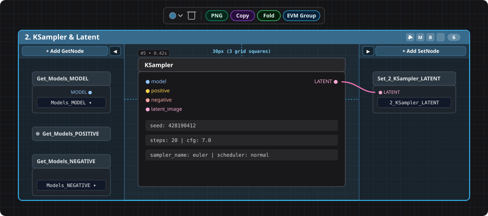

# ⚡ ComfyUI-EVM-Advanced-Group

**EVM Advanced Group** is a smart group container for **ComfyUI**. It keeps complex workflows clean and modular, removes the "spaghetti" of links crossing the canvas, and keeps everything aligned to ComfyUI's native grid.



---

## ✨ Key Features

- **🗂️ Smart side rails (`GetNode` & `SetNode`):**
  - **Left rail (`GetNode`):** holds every input coming from other groups (`+ Add GetNode`).
  - **Right rail (`SetNode`):** holds every output the group exports (`+ Add SetNode`).
  - **Automatic naming:** when you connect any node output to a `SetNode` docked in the right rail, it is renamed to `<GroupName>_<TYPE>` (e.g. `2_KSampler_Latent_LATENT`). The value is written to both `widgets_values` and `widgets_values_named`. The node's title shows the same name with a `Set_` prefix.
  - **Rename sync:** double-click the group title and rename it; the prefix of every `SetNode` in the group, and of every paired `GetNode` in the whole workflow, is updated automatically.
  - **Collapsible rails (`◀` / `▶`):** hide a rail you don't need while the **central area stays in place** on the canvas. Quick pills `▶ Get (N)` and `Set (N) ◀` stay in the header.
- **📐 Grid-aligned geometry (`10px` grid, `30px` margins):**
  - Inner padding of **3 grid cells (`30px`)** on every side, measured at the top from the **bottom of the title bar** (`g.y + 30px`) to the real visual top of the nodes (`pos[1] - 30px`).
  - Vertical spacing of **30px free space + the 30px node title bar = 60px**, so ComfyUI's native badge above each node (`#ID` and execution time) never touches the node above it.
- **🔄 Live auto-resize & auto-reflow:**
  - **Live resizing:** stretch any node horizontally or vertically and the neighboring columns and the group's width/height adjust in real time.
  - **Collapse support:** collapsing or expanding any `GetNode`, `SetNode` or central node moves the nodes below it up or down (no overlap) and shrinks or grows the rail to fit its widest item.
  - **Collision avoidance:** when a group grows, neighboring groups are pushed away so nothing overlaps.
- **🎨 Native ComfyUI colors (`LGraphCanvas.node_colors`):**
  - Uses ComfyUI's official group palette (*Pale Blue, Red, Brown, Green, Blue, Cyan, Purple, Yellow, Black*) with a `● ⌄` color picker that matches the native Selection Toolbox.
- **🖱️ Full multi-selection and one-click conversion:**
  - Native **marquee selection**, **`Shift / Ctrl + Click`** in any order (groups + nodes, or several groups), **`Ctrl + A`**, and synchronized dragging.
  - An **`EVM Group`** pill button in **ComfyUI's native Selection Toolbox** wraps the selected nodes, or converts native groups / Pixaroma Groups, in one click.
- **🪄 Workflow organizer:** right-click the canvas → `🪄 Organize Workflow` to split a whole workflow into stage groups, wire them with `SetNode` / `GetNode`, and color each stage. `↩️ Undo Last Organize` restores the previous layout.
- **⚙️ Native Settings panel (`⚡ EVM Advanced Group`):**
  - 18 options directly in ComfyUI's **Settings (⚙️)** dialog.

---

## 📦 Installation

Inside your `ComfyUI/custom_nodes/` folder, run:

```bash
cd ComfyUI/custom_nodes
git clone https://github.com/eduvm/ComfyUI-EVM-Advanced-Group.git
```

Restart ComfyUI and reload the browser page (`F5`).

> **💡 Required for the side rails:** `GetNode` and `SetNode` come from [**ComfyUI-KJNodes**](https://github.com/kijai/ComfyUI-KJNodes). Install it to use the `+ Add GetNode` and `+ Add SetNode` buttons. Grouping, layout and colors work without it.

---

## 🚀 Usage Examples

### Example 1: Group the selected nodes in one click
1. Select one or more nodes on the canvas (drag a selection rectangle or hold `Shift + Click`).
2. In the **native Selection Toolbox** that appears above the selection, click the blue **`EVM Group`** pill *(or right-click the canvas → `⚡ Add EVM Group (Set/Get)`)*.
3. An **EVM Advanced Group** is created around the nodes and arranges them in columns aligned to the `10px` grid, with `30px` margins and spacing.

### Example 2: Pass data between groups without crossing links (`SetNode` / `GetNode`)
1. In the producer group (e.g. `1. Models & Conditioning`), click **`+ Add SetNode`** at the top of the right rail.
2. Connect the `MODEL` output of your `CheckpointLoaderSimple` to the `SetNode` input.
3. The `SetNode` is renamed to **`1_Models_Conditioning_MODEL`** (its title shows `Set_1_Models_Conditioning_MODEL`), and the right rail resizes to fit the text.
4. In the next group (e.g. `2. KSampler & Latent`), click **`+ Add GetNode`** in the left rail, pick `1_Models_Conditioning_MODEL` in the combo, and connect it to the `KSampler`.
5. If a group needs no inputs (like the first group of the workflow), click the **`◀`** arrow on the left rail to collapse it. A compact **`▶ Get`** pill stays available in the header.

### Example 3: Convert a native ComfyUI group or a Pixaroma Group
1. Click any **native ComfyUI group** or **Pixaroma Group** in your workflow.
2. Click the **`EVM Group`** button in the floating action bar above the group.
3. The group is converted into an **EVM Advanced Group**, keeping its title and color, and its nodes are aligned with the 30px spacing rule.

### Example 4: Run, mute, bypass or fold a whole group
The top-right corner of every **EVM Advanced Group** title bar has 4 quick action buttons plus the node count:
- **▶ (Run Group):** queues only the output nodes (`SaveImage`, `PreviewImage`, etc.) inside that group.
- **🔇 (Mute Group):** toggles `Mute` on every central node in the group.
- **⏭️ (Bypass Group):** toggles `Bypass` on every central node in the group.
- **🔼 / 🔽 (Fold / Unfold):** collapses the whole group into a compact `30px` bar, hiding the nodes inside. While the group runs, a green progress bar is drawn on the folded bar.

---

## 📂 Example Workflow (`example_workflows/`)

This package ships a complete demo workflow you can open in ComfyUI:

- 📄 **[`example_workflows/EVM_Advanced_Group_Example_Pipeline.json`](./example_workflows/EVM_Advanced_Group_Example_Pipeline.json)**

It shows a modular pipeline split into **3 EVM Advanced Groups** connected only through `SetNode` / `GetNode` rails:
1. **`1. Models & Conditioning`** *(Pale Blue — left rail collapsed `▶ Get`, right rail with 4 auto-named `SetNode`s: `MODEL`, `CONDITIONING`, `CONDITIONING_2`, `VAE`)*.
2. **`2. KSampler & Latent`** *(Purple — left rail with 3 `GetNode`s, central area with `EmptyLatentImage` + `KSampler`, right rail exporting `2_KSampler_Latent_LATENT`)*.
3. **`3. VAE Decode & Output`** *(Green — left rail receiving `LATENT` and `VAE`, central area with `VAEDecode` + `SaveImage`, right rail collapsed `Set ◀`)*.

> **How to open:** drag `example_workflows/EVM_Advanced_Group_Example_Pipeline.json` into the ComfyUI window, or use **Workflow → Browse Templates → EVM Advanced Group**.

---

## ⚙️ Settings (`Settings → ⚡ EVM Advanced Group`)

Open ComfyUI's settings (**⚙️ Settings**) and select the **`⚡ EVM Advanced Group`** tab. Changes apply immediately.

| Section | Setting | Default | Description |
|---|---|---|---|
| **1. Layout & Grid** | **Inner Padding** | `3` (`30px`) | Space, in `10px` grid cells, between the group's borders/header and the nodes inside (`1` to `8`). |
| **1. Layout & Grid** | **Vertical Gap** | `3` (`30px` free) | Free vertical space between nodes in the same column (`30px` free + `30px` title bar/`#ID` badge = `60px`). |
| **1. Layout & Grid** | **Horizontal Gap** | `3` (`30px`) | Horizontal space between node columns in the central area (`1` to `10` cells). |
| **1. Layout & Grid** | **Column Tolerance** | `100px` | Maximum X-axis difference for two nodes to be treated as the same column (`30px` to `240px`). |
| **1. Layout & Grid** | **Auto-Reflow** | `On` | Moves neighbors and resizes the group live when any node is resized or collapsed/expanded. |
| **1. Layout & Grid** | **Group Collision Avoidance** | `On` | Pushes neighboring groups away when a group grows. |
| **1. Layout & Grid** | **Snap to Grid (`10px`)** | `On` | Keeps every position and size at exact multiples of `10px`. |
| **2. Set / Get Rails** | **Left Rail (GetNode)** | `On` | Whether new groups start with the left rail open. |
| **2. Set / Get Rails** | **Right Rail (SetNode)** | `On` | Whether new groups start with the right rail open. |
| **2. Set / Get Rails** | **Minimum Rail Width** | `140px` | Minimum usable width of the rails when empty or with short names (`100px` to `260px`). |
| **2. Set / Get Rails** | **Auto-Naming Format** | `<Group>_<TYPE>` | Name given to a docked `SetNode` when a link is connected (`<Group>_<TYPE>`, `<TYPE>_<Group>` or `Off`). |
| **2. Set / Get Rails** | **Sync Rename** | `On` | Renames the paired `SetNode`s and `GetNode`s when the group title changes. |
| **3. Appearance & Header** | **Default Color** | `Pale Blue (#3f789e)` | Initial color for new groups, from ComfyUI's default palette. |
| **3. Appearance & Header** | **Font Size** | `16px` | Title bar font size (`12px` to `24px`). |
| **3. Appearance & Header** | **Title Opacity** | `78%` | Opacity of the title bar (`25%` to `100%`). |
| **3. Appearance & Header** | **Body Opacity** | `22%` | Opacity of the group's inner fill (`5%` to `65%`). |
| **3. Appearance & Header** | **Header Buttons** | `Always visible` | Shows `Run, Mute, Bypass, Fold` always, only on hover/selection, or in compact mode (`Fold` only). |
| **3. Appearance & Header** | **Links When Folded** | `On` | Keeps external links visible on folded groups. |
| **4. Action Bar (Toolbox)** | **Floating Group Bar** | `On` | Shows the floating pill bar (`Color ● ⌄`, `Delete 🗑️`, `Fold`) above the selected group. |
| **4. Action Bar (Toolbox)** | **Native Selection Toolbox Button** | `On` | Shows the `EVM Group` pill button in ComfyUI's native selection bar. |

---

## ⌨️ Mouse & Keyboard Shortcuts

| Action | Shortcut / Interaction |
|---|---|
| **Rename group (and sync Set/Get)** | `Double-click` the group title bar |
| **Select several groups and/or nodes** | Drag a selection rectangle (marquee) or `Shift + Click` / `Ctrl + Click` in any order |
| **Select all groups and nodes** | `Ctrl + A` |
| **Move several groups and nodes together** | Drag the header of any selected group, or drag any co-selected node |
| **Resize a group manually** | Drag any of the group's 4 corners |
| **Delete selected group(s) (keeping the nodes)** | `Delete` or `Backspace` (or the `🗑️` icon in the floating bar) |

---

## 🧩 Global JavaScript API (`window.EVMAdvancedGroup`)

Other ComfyUI extensions can drive **EVM Advanced Group** through `window.EVMAdvancedGroup` (or the compatible alias `window.EVMGroupSetGet`):

```javascript
// Create an EVM Advanced Group from the currently selected nodes
const group = window.EVMAdvancedGroup.createGroup(null, {
    title: "My Modular Group",
    color: "#3f789e",
});

// Re-arrange the group's nodes on the 30px grid
window.EVMAdvancedGroup.tidyGroup(group);

// Add a GetNode (left) or SetNode (right) from code
window.EVMAdvancedGroup.addGetNode(group);
window.EVMAdvancedGroup.addSetNode(group);

// Toggle the side rails or fold the group
window.EVMAdvancedGroup.toggleLeftRail(group);
window.EVMAdvancedGroup.toggleRightRail(group);
window.EVMAdvancedGroup.toggleFold(group);
```

---

## 📄 License

Released under the **MIT** license. See [`LICENSE`](./LICENSE) for details.
